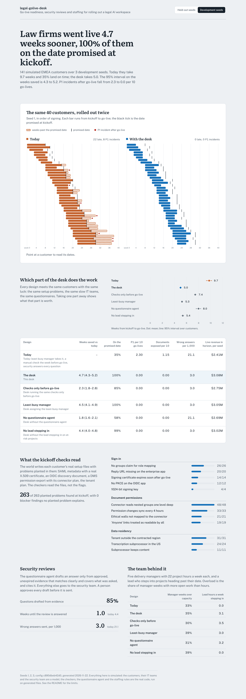

# legal-golive-desk

A delivery desk for rolling out a legal AI workspace to law firms and legal teams across EMEA. It does the four things
that decide whether a firm goes live on the date promised at kickoff:

1. **Readiness checks at kickoff**, run on the files the firm's IT team sends: SAML metadata (real X.509 certificate
   expiry, key size, reply URL, email and group claims), OIDC discovery (code flow, PKCE, signing algorithms), the DMS
   permission export against the planned iManage or SharePoint connector (ethical walls, nested groups, "anyone" links,
   permission sync), and the tenant plan against the contract's data residency (region, backups, subprocessors,
   retention).
2. **A security-questionnaire agent** that drafts answers only from approved, unexpired evidence, cites it, answers
   German questions too, and sends everything it cannot cover to the security team.
3. **Staffing** that matches each go-live to a delivery manager on integration skills, language and load.
4. **An early warning** that tells the lead which projects are heading past their promised date, so the lead steps in
   and escalates while there is still time.

Each part is measured on simulated EMEA rollouts against how many teams work today: the least-busy manager takes the
customer, a person checks the setup by hand the week before go-live, and security answers every questionnaire.



## Results

<!-- results:start -->

_Generated by `python -m golive.eval.cli readme` from `reports/`. Do not edit by hand._

### Development seeds [1, 2, 3] · config `cb3c3f3318ea` · gates pass

On 3 dev seeds (141 simulated customers), the desk took customers live in 5.0 weeks against 9.7 today: 4.7 weeks sooner (95% interval 4.3–5.2), 100% on the committed date against 35%, and 0.0 P1 incidents per 10 go-lives against 2.3.

| Design | Weeks to go-live | On time | P1 per 10 go-lives | Exposures per 10 | Wrong answers per 1,000 | Security turnaround (weeks) | Weeks saved vs today |
|---|---|---|---|---|---|---|---|
| Today: least-busy manager takes it, a manual check the week before go-live, security answers every question | 9.7 (9.3–10.2) | 35% | 2.30 | 1.15 | 21.1 | 4.4 | – |
| Checks at kickoff, managers matched on skills and language, the questionnaire agent, the lead stepping in | 5.0 (4.8–5.2) | 100% | 0.00 | 0.00 | 3.0 | 1.0 | 4.7 (4.3–5.2) |
| Desk running the same checks only before go-live | 7.4 (7.2–7.7) | 85% | 0.00 | 0.00 | 3.0 | 1.0 | 2.3 (1.8–2.8) |
| Desk assigning the least-busy manager | 5.3 (5.1–5.5) | 100% | 0.00 | 0.00 | 3.0 | 1.0 | 4.5 (4.1–4.9) |
| Desk without the questionnaire agent | 8.0 (7.6–8.4) | 58% | 0.00 | 0.00 | 21.1 | 4.4 | 1.8 (1.6–2.1) |
| Desk without the lead stepping in on at-risk projects | 5.4 (5.2–5.6) | 99% | 0.00 | 0.00 | 3.0 | 1.0 | 4.4 (4.0–4.8) |

| Design | Revenue live inside the horizon, per seed | Manager-weeks over capacity | Lead hours per week stepping in |
|---|---|---|---|
| Today: least-busy manager takes it, a manual check the week before go-live, security answers every question | $2.41M | 33% | 0.0 |
| Checks at kickoff, managers matched on skills and language, the questionnaire agent, the lead stepping in | $3.08M | 35% | 3.1 |
| Desk running the same checks only before go-live | $2.75M | 30% | 3.5 |
| Desk assigning the least-busy manager | $3.05M | 38% | 3.0 |
| Desk without the questionnaire agent | $2.69M | 31% | 3.2 |
| Desk without the lead stepping in on at-risk projects | $3.02M | 39% | 0.0 |

Planted setup problems: 263; found by the kickoff checks: 263; blocker findings no planted problem explains: 0; questionnaire questions: 13,848.

_The held-out seeds have not been run yet._

<!-- results:end -->

## How it is measured

`golive/world/` simulates a region: law firms sign at about 1.6 a week for 26 weeks, each with a DMS (iManage Cloud,
iManage on-premises, SharePoint, NetDocuments), an identity provider, a language, a size, a residency requirement and a
security questionnaire of 60–140 questions in English or German. The world plants problems in each customer's setup
and writes them into real files: SAML metadata with a generated certificate, an OIDC discovery document, a DMS
permission export with nested practice groups and ethical walls, a connector plan and a tenant plan. It also decides
how long the customer's IT team takes to fix things and what happens after go-live when a problem slips through: an
expired certificate locks everyone out, an unmapped wall exposes walled-off documents, a US transcription subprocessor
breaks a German contract.

Five delivery managers with 22 project hours a week, a security team with 20 hours a week and a lead with 8 hours a week
work through 40 weeks. Every design meets the same customers with the same luck (`golive/keyed.py`): random draws are
keyed by what they are about, so a design changes only what the design changes.

| Design | What it changes |
|---|---|
| Today | least-busy manager, manual check the week before go-live (finds some problems), security answers every question |
| The desk | all four parts above |
| Checks only before go-live | the same checks, run late instead of at kickoff |
| Least-busy manager | no skill or language matching |
| No questionnaire agent | security answers every question |
| No lead stepping in | no early warning |

Intervals resample customers (1,000 bootstrap draws). Weeks saved are paired: the same customer under both designs.

## Run it

```bash
pip install -r requirements.txt
pytest -q
python -m golive.eval.cli dev        # writes reports/dev.json, reports/REPORT.md and the block above
python -m golive.eval.cli gate
uvicorn golive.service.app:app       # the API, docs at http://127.0.0.1:8000/docs
cd web && npm ci && npm run dev      # the dashboard
```

Ask the desk about a customer's SAML metadata:

```bash
curl -s localhost:8000/checks/sso/saml -H 'content-type: application/json' -d '{
  "metadata_xml": "<EntityDescriptor …/>", "sp_entity_id": "https://workspace.example/sp",
  "acs_url": "https://workspace.example/acs", "go_live": "2027-01-15",
  "configured_reply_urls": ["https://workspace.example/acs"]}'
```

| Endpoint | Reads | Returns |
|---|---|---|
| `POST /checks/sso/saml` | IdP federation metadata XML | findings with severity and fix; ready or not |
| `POST /checks/sso/oidc` | `/.well-known/openid-configuration` | same |
| `POST /checks/dms` | permission export and connector plan | exposed and hidden user-document pairs, their causes, findings |
| `POST /checks/residency` | contract requirement and tenant plan | findings |
| `POST /questionnaires/answer` | up to 500 questions | drafted answers with citations, the rest routed to security |
| `POST /delivery/assign` | intake and team | the manager to take it and expected hours |

Set `ANTHROPIC_API_KEY` and pass a `ClaudeRephraser` to the agent to have Claude reword approved evidence to fit each
question. Code throws a rewording away if it drops the citation or adds a number the evidence does not contain.

## Limits

- **Everything outside the code is simulated.** The customers, their IT and security reviewers, the delivery team's
  hours and what breaks after go-live are a model with rates I chose (`config/world.json`). No real tenant, DMS or
  customer data was used. The checkers, the agent and the staffing rules are real code, run on generated files.
- **Recall is 100% by construction** for the twelve problem kinds the world plants, because the files are generated to
  contain them. It says nothing about problems the world does not know how to plant. Real metadata and DMS exports are
  messier.
- **The questionnaire's thresholds were tuned on dev seed 1** and the question bank is shared by dev and held-out seeds:
  the held-out run tests the delivery simulation's luck, not new phrasings. The agent drafts 41 of the 50 bank questions
  that have evidence, and only 7 of the 13 German ones; German compounds and inflections defeat its crude stemming.
- **The permission audit expands groups from an export.** Real iManage and SharePoint permissions also include
  inheritance breaks, external users and security-trimmed search behaviour that are not modelled here.
- **Skill matching is worth little in this world** (0.2 weeks); its value depends on how much slower a manager is on an
  unfamiliar DMS, which is a rate I set, not one I measured.
- **The desk is not lighter on the team.** Manager-weeks over capacity are about the same as today; the time saved goes
  into more customers live sooner.

## Layout

```
golive/sso.py, dms.py, residency.py   readiness checks
golive/questionnaire.py               the security-questionnaire agent
golive/delivery.py                    staffing and early warning
golive/service/app.py                 FastAPI service
golive/world/                         the simulated region (truth lives here)
golive/eval/                          runner, report, gates, held-out lock
config/                               world, product, designs, gates, seeds, approved evidence
web/                                  dashboard (React, Vite, Framer Motion)
docs/adr/                             decisions
```
